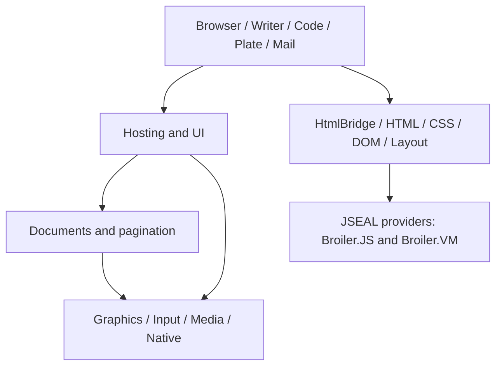

# Broiler Platform

> **Browser and Office Infrastructure in Intermediate Language with Enhanced Reliability**

[](https://github.com/Broiler-Platform/.github/blob/main/LICENSE)
[](#getting-started)
[](https://github.com/Broiler-Platform/.github/blob/main/profile/docs/architecture.md)

Broiler is an open-source software platform exploring a deliberately ambitious question:

> **Can modern browser and office applications be built entirely in managed .NET?**

No Chromium. No embedded WebView. No native browser engine. Just managed .NET, modular architecture, open standards, automated verification, AI-assisted engineering, and human review.

Broiler is **not** a wrapper around an existing browser or office stack. It is a reusable platform for building browsers, office applications, document software, and future web-enabled tools on top of a shared managed runtime — built around a simple idea:

> Important application infrastructure should remain understandable, inspectable, portable, and replaceable.

> [!NOTE]
> Broiler is under active development and is **not yet intended for production use**.

---

## Platform Snapshot

| Component | Status |
|-----------|--------|
| Standards verification | Test262, WPT and reftest tooling; current figures require revision-linked evidence ([status](https://github.com/Broiler-Platform/.github/blob/main/profile/docs/status.md)) |
| Supported Platforms | Windows, Linux, Android, WebAssembly |
| Applications | Browser, Writer, Code, Plate, Mail |
| Reference Deployment | BOSS |
| Document Formats | RTF, HTML, Markdown, DOCX, ODT, CSV, PDF *(preview subset)* |
| Native Compilation | Writer *(win-x64, linux-x64)* and Plate *(win-x64)* publish paths; Mail *(win-x64, win-arm64)* validation packaging uses **NativeAOT** |
| Repository Layout | 26 component submodules — 5 primary applications, shared libraries and projects under development ([Component Map](https://github.com/Broiler-Platform/.github/blob/main/profile/docs/component-map.md)) |

---

## Architecture at a Glance

The aggregate checkout pins component repositories as Git submodules and owns integration tooling, tests and BOSS. Components consume one another through NuGet packages, with project references within each repository. The generated map contains **26 components and 70 declared dependency edges**, including optional and conditional paths, as of **21 October 2026**.



This is a conceptual overview; direct references, scan scope and source evidence are in the component map. Broiler.VM and Fond have implementation work but retain acceptance gates.

The full wiring — who depends on whom, in both directions — is in the
**[Component Map](https://github.com/Broiler-Platform/.github/blob/main/profile/docs/component-map.md)**.

[](https://github.com/Broiler-Platform/.github/blob/main/profile/docs/component-map.md)

### Applications

| Application | What it is | Heads |
|-------------|------------|-------|
| **Broiler Browser** | Reference browser — the full web stack end to end | Windows, Linux, Android |
| **Broiler Writer** | Word processor and reference office application | Windows, Linux, Android, WebAssembly |
| **Broiler Code** | Code editor with C# language services and a human-review workspace | Windows, Linux |
| **Broiler Plate** | Read-only viewer — the smallest honest demonstration of what the platform can already read | Windows |
| **Broiler Mail** | Mail client — Single-account reader with SMTP composition and HTML preview work; provider acceptance and renderer isolation remain open | Windows, Android; Linux placeholder |
| **BOSS** | Broiler Office Standalone Server — hosts the WebAssembly Writer via ASP.NET Core | self-hosted |

---

## Enhanced Reliability

The **"Enhanced Reliability"** part of the name reflects the project's engineering philosophy.

```text
Managed .NET
+ Modular Architecture
+ Open Standards
+ AI-Assisted Engineering
+ Human Review
+ Automated Verification
--------------------------------------------------
= Enhanced Reliability
```

AI can generate code rapidly. Reliable browser and office infrastructure requires considerably more. Broiler therefore combines AI-assisted development with modular design, standards compliance, automated verification, and human review.

Each part of that formula is described in [Engineering Principles](https://github.com/Broiler-Platform/.github/blob/main/profile/docs/principles.md).

---

## Documentation

| Document | Contents |
|----------|----------|
| [Status and Roadmap](https://github.com/Broiler-Platform/.github/blob/main/profile/docs/status.md) | What works today, what is in progress, what comes next |
| [Architecture and Deployment](https://github.com/Broiler-Platform/.github/blob/main/profile/docs/architecture.md) | Platform layers, desktop/mobile/web, self-hosting, open infrastructure |
| [Component Map](https://github.com/Broiler-Platform/.github/blob/main/profile/docs/component-map.md) | Every component, what it owns, and what it depends on — in both directions |
| [Engineering Principles](https://github.com/Broiler-Platform/.github/blob/main/profile/docs/principles.md) | Managed .NET, standards first, security, modularity, AI + human review |
| [Why Broiler](https://github.com/Broiler-Platform/.github/blob/main/profile/docs/why-broiler.md) | Why the platform exists, why .NET, why another browser and office |
| [Project Story](https://github.com/Broiler-Platform/.github/blob/main/profile/docs/project-story.md) | How Broiler started, and acknowledgements |
| [Native Compilation](https://github.com/Broiler-Platform/.github/blob/main/profile/docs/native-compilation.md) | NativeAOT: self-contained native binaries, and what that constrains |
| [Current Preview](https://github.com/Broiler-Platform/.github/blob/main/profile/docs/screenshots.md) | Screenshots of the browser, the writer, and standards tests |

---

## Getting Started

Each application releases on its own schedule, from its own repository:

| Application | Latest preview | Builds |
|---|---|---|
| **Broiler Browser** | [Releases](https://github.com/Broiler-Platform/Broiler.Browser/releases) | `win-x64` and `linux-x64`, each self-contained or framework-dependent · Android `.apk` / `.aab` |
| **Broiler Writer** | [Releases](https://github.com/Broiler-Platform/Broiler.Writer/releases) | `win-x64` and `linux-x64`, self-contained *(NativeAOT)* or framework-dependent · Android `.apk` / `.aab` |
| **Broiler Plate** | [Releases](https://github.com/Broiler-Platform/Broiler.Plate/releases) | `win-x64` *(NativeAOT)* |
| **Broiler Code** | build from [source](https://github.com/Broiler-Platform/Broiler.Code) | no release yet |
| **Broiler Mail** | [Source and workflows](https://github.com/Broiler-Platform/Broiler.Mail) | Windows x64/ARM64 and Android validation packaging; unsigned builds and draft releases |

Then:

- Run the Writer through BOSS
- Build on the platform directly — components publish as NuGet preview packages
- Read the source — each application and each component is its own repository; the [Component Map](https://github.com/Broiler-Platform/.github/blob/main/profile/docs/component-map.md) is the index
- Report bugs and compatibility problems on the repository they belong to

> [!NOTE]
> The combined development snapshots are discontinued. The last one was the Final Broiler
> Preview Package of August 2026; everything since then ships per application, from that
> application's own repository.

Feedback and contributions are always appreciated.

---

## Contributing

Contributions of all kinds are welcome — code, documentation, testing, ideas, interoperability reports, or security analysis.

Please read `CONTRIBUTING.md`, `CODE_OF_CONDUCT.md` and `SECURITY.md` before opening a pull request.

---

## License

Broiler is licensed under the **Apache License 2.0**.
