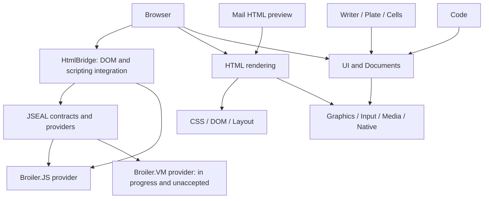
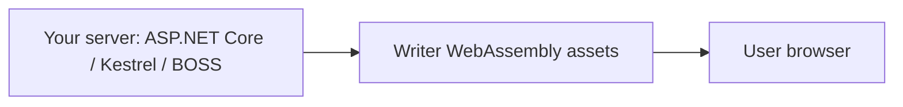

# Architecture and Deployment

[← Back to Broiler Platform](https://github.com/Broiler-Platform)

Updated against the aggregate checkout on **23 October 2026**.

## Repository and build model

The [Broiler aggregate](https://github.com/Broiler-Platform/Broiler) pins 27 component repositories as Git submodules. It also owns cross-component integration, validation tools and the Broiler Office Standalone Server (BOSS). Component repositories own their application or library code, solutions, tests and workflows.

Cross-component product dependencies in the current scan use NuGet package references; projects within a component use project references. The [Component Map](component-map.md) is generated from component-owned tracked product project files and includes optional and conditional references. Its 74 component edges form an acyclic graph. This declaration graph does not establish that every package has been published or that every configuration has passed validation.

## Shared stacks

This is a conceptual overview; the component map records direct references. The browser and office paths share UI, document and device infrastructure. Writer does not directly reference the HTML renderer or JavaScript engine. Browser also directly consumes Documents, so these are overlapping stacks rather than disjoint ones.

JSEAL separates engine-neutral contracts from engine providers. `Broiler.JSeal` has no package or project references; `Broiler.JSeal.BroilerJs` and `Broiler.JSeal.Vm` implement its contracts. Browser VM configurations select the optional VM scripting provider, but HtmlBridge's DOM binding still reaches Broiler.JS. Choosing the VM does not remove the existing engine from that closure.

Broiler.Hosting provides shared operating-system integration, including windowing, clipboard, DPI and theme handling. Native platform bindings live in Broiler.Native; managed engines still rely on operating-system services through these boundaries.

## Application heads

| Application | Windows | Linux | Android | WebAssembly |
|---|---|---|---|---|
| Browser | Head | Head | Head | — |
| Writer | Head | Head | Head | Head, served by BOSS |
| Code | Head | Head | — | — |
| Plate | Head | — | — | — |
| Mail | Head | Placeholder; no interactive window | Head | — |
| Cells | Head | — | — | — |

A head's presence is implementation evidence, not platform acceptance. Android physical-device and accessibility validation remains component-specific. Broiler.Fond is an additional application under development, with a finance kernel and synthetic protocol fixtures; it is not a supported banking client.

## Browser deployment and self-hosting

BOSS hosts Writer's browser assets. Browser WebAssembly deployment and a WebAssembly guest executed by Broiler.VM are distinct mechanisms. See [Native Compilation](native-compilation.md).

Open source components, explicit composition and self-hosting keep the infrastructure inspectable and replaceable. Public APIs and behavior remain preview surfaces. Component human-review records and support ledgers determine release acceptance.

See [Component Map](component-map.md), [Status and Roadmap](status.md), and [Engineering Principles](principles.md).
