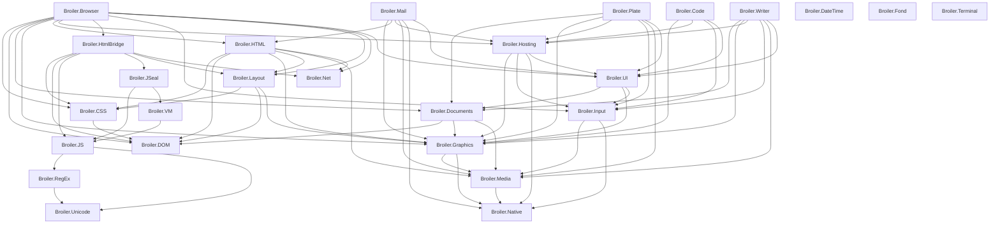

# Component Map

[← Back to Broiler Platform](https://github.com/Broiler-Platform)

Updated from the aggregate checkout on **2026-10-21**. The aggregate pins 26 component repositories as Git submodules and also owns integration tools, tests and BOSS. It is not itself a node here.

## Reading the graph

Arrows point from consumer to dependency. This is the union of declared references in component-owned product `.csproj` files, including conditional references and optional providers. It is not the dependency closure of every application build. Tests, samples, demos, benchmarks, documentation and tooling directories are excluded; nested submodule copies are not scanned. Package IDs are mapped to their owning component. References imported from props/targets and resolved NuGet transitive dependencies are outside this scan.

The [machine-readable snapshot](component-map.json) records source commits, tracked changes, project counts and reference evidence. Regenerate from the documentation repository with `python scripts/update-component-map.py D:/Broiler`. Working-tree project contents are used; this records declarations, not a successful build, package availability or release approval.

## Diagram

## Dependencies in both directions

Levels are computed as the longest dependency path to a leaf. An isolated node means no cross-component reference was found in this scan; it does not mean no implementation exists.

| Level | Component | Depends on | Used by |
|---:|---|---|---|
| 6 | **Broiler.Browser** | `Broiler.CSS`, `Broiler.DOM`, `Broiler.Documents`, `Broiler.Graphics`, `Broiler.HTML`, `Broiler.Hosting`, `Broiler.HtmlBridge`, `Broiler.Input`, `Broiler.Layout`, `Broiler.Net`, `Broiler.UI` | — |
| 6 | **Broiler.Code** | `Broiler.Graphics`, `Broiler.Hosting`, `Broiler.Input`, `Broiler.UI` | — |
| 6 | **Broiler.Mail** | `Broiler.Graphics`, `Broiler.HTML`, `Broiler.Hosting`, `Broiler.Media`, `Broiler.Native`, `Broiler.UI` | — |
| 6 | **Broiler.Plate** | `Broiler.Documents`, `Broiler.Graphics`, `Broiler.Hosting`, `Broiler.Input`, `Broiler.Media`, `Broiler.UI` | — |
| 6 | **Broiler.Writer** | `Broiler.Documents`, `Broiler.Graphics`, `Broiler.Hosting`, `Broiler.Input`, `Broiler.Media`, `Broiler.UI` | — |
| 5 | **Broiler.Hosting** | `Broiler.Graphics`, `Broiler.Input`, `Broiler.Native`, `Broiler.UI` | `Broiler.Browser`, `Broiler.Code`, `Broiler.Mail`, `Broiler.Plate`, `Broiler.Writer` |
| 5 | **Broiler.HtmlBridge** | `Broiler.CSS`, `Broiler.DOM`, `Broiler.JS`, `Broiler.JSeal`, `Broiler.Layout`, `Broiler.Net` | `Broiler.Browser` |
| 4 | **Broiler.HTML** | `Broiler.CSS`, `Broiler.DOM`, `Broiler.Graphics`, `Broiler.Layout`, `Broiler.Media`, `Broiler.Net` | `Broiler.Browser`, `Broiler.Mail` |
| 4 | **Broiler.JSeal** | `Broiler.JS`, `Broiler.VM` | `Broiler.HtmlBridge` |
| 4 | **Broiler.UI** | `Broiler.Documents`, `Broiler.Graphics`, `Broiler.Input` | `Broiler.Browser`, `Broiler.Code`, `Broiler.Hosting`, `Broiler.Mail`, `Broiler.Plate`, `Broiler.Writer` |
| 3 | **Broiler.Documents** | `Broiler.DOM`, `Broiler.Graphics`, `Broiler.Media` | `Broiler.Browser`, `Broiler.Plate`, `Broiler.UI`, `Broiler.Writer` |
| 3 | **Broiler.Layout** | `Broiler.CSS`, `Broiler.DOM`, `Broiler.Graphics` | `Broiler.Browser`, `Broiler.HTML`, `Broiler.HtmlBridge` |
| 3 | **Broiler.VM** | `Broiler.JS` | `Broiler.JSeal` |
| 2 | **Broiler.Graphics** | `Broiler.Media`, `Broiler.Native` | `Broiler.Browser`, `Broiler.Code`, `Broiler.Documents`, `Broiler.HTML`, `Broiler.Hosting`, `Broiler.Layout`, `Broiler.Mail`, `Broiler.Plate`, `Broiler.UI`, `Broiler.Writer` |
| 2 | **Broiler.Input** | `Broiler.Media`, `Broiler.Native` | `Broiler.Browser`, `Broiler.Code`, `Broiler.Hosting`, `Broiler.Plate`, `Broiler.UI`, `Broiler.Writer` |
| 2 | **Broiler.JS** | `Broiler.RegEx`, `Broiler.Unicode` | `Broiler.HtmlBridge`, `Broiler.JSeal`, `Broiler.VM` |
| 1 | **Broiler.CSS** | `Broiler.DOM` | `Broiler.Browser`, `Broiler.HTML`, `Broiler.HtmlBridge`, `Broiler.Layout` |
| 1 | **Broiler.Media** | `Broiler.Native` | `Broiler.Documents`, `Broiler.Graphics`, `Broiler.HTML`, `Broiler.Input`, `Broiler.Mail`, `Broiler.Plate`, `Broiler.Writer` |
| 1 | **Broiler.RegEx** | `Broiler.Unicode` | `Broiler.JS` |
| 0 | **Broiler.DOM** | — | `Broiler.Browser`, `Broiler.CSS`, `Broiler.Documents`, `Broiler.HTML`, `Broiler.HtmlBridge`, `Broiler.Layout` |
| 0 | **Broiler.DateTime** | — | — |
| 0 | **Broiler.Fond** | — | — |
| 0 | **Broiler.Native** | — | `Broiler.Graphics`, `Broiler.Hosting`, `Broiler.Input`, `Broiler.Mail`, `Broiler.Media` |
| 0 | **Broiler.Net** | — | `Broiler.Browser`, `Broiler.HTML`, `Broiler.HtmlBridge` |
| 0 | **Broiler.Terminal** | — | — |
| 0 | **Broiler.Unicode** | — | `Broiler.JS`, `Broiler.RegEx` |

## Dependency counts

Counts are distinct component edges, not package or assembly counts.

| Component | Consumers (fan-in) | Dependencies (fan-out) |
|---|---:|---:|
| Broiler.Graphics | 10 | 2 |
| Broiler.Media | 7 | 1 |
| Broiler.DOM | 6 | 0 |
| Broiler.Input | 6 | 2 |
| Broiler.UI | 6 | 3 |
| Broiler.Hosting | 5 | 4 |
| Broiler.Native | 5 | 0 |
| Broiler.CSS | 4 | 1 |
| Broiler.Documents | 4 | 3 |
| Broiler.JS | 3 | 2 |
| Broiler.Layout | 3 | 3 |
| Broiler.Net | 3 | 0 |
| Broiler.HTML | 2 | 6 |
| Broiler.Unicode | 2 | 0 |
| Broiler.HtmlBridge | 1 | 6 |
| Broiler.JSeal | 1 | 2 |
| Broiler.RegEx | 1 | 1 |
| Broiler.VM | 1 | 1 |
| Broiler.Browser | 0 | 11 |
| Broiler.Code | 0 | 4 |
| Broiler.DateTime | 0 | 0 |
| Broiler.Fond | 0 | 0 |
| Broiler.Mail | 0 | 6 |
| Broiler.Plate | 0 | 6 |
| Broiler.Terminal | 0 | 0 |
| Broiler.Writer | 0 | 6 |

## Important boundaries

- JSEAL contracts are engine-neutral; `Broiler.JSeal.BroilerJs` and `Broiler.JSeal.Vm` provide engine-specific implementations. A component-level arrow from JSEAL to an engine describes a provider, not the contracts assembly.
- The Browser's VM configurations select an optional VM scripting provider. HtmlBridge's DOM binding still reaches Broiler.JS; selecting the VM does not remove that dependency.
- Broiler.VM contains core, JavaScript and WebAssembly profile projects and native artifact execution work. Its VM-0 through VM-7 milestones remain in progress and unaccepted; implementation does not establish supported deployment or human approval.
- Broiler.Fond has an in-progress finance kernel and synthetic protocol fixtures. Its application and authenticated banking capabilities remain under development.

See [Architecture](architecture.md), [Status](status.md), and [Native Compilation](native-compilation.md).
