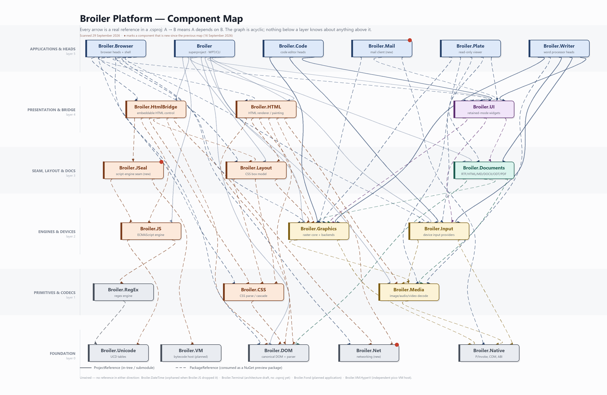

# Component Map

[← Back to Broiler Platform](https://github.com/Broiler-Platform)

Broiler is not one repository. It is a set of independently versioned components, each
owning one concern, wired together by explicit typed references — the composition rule
that [Native Compilation](https://github.com/Broiler-Platform/.github/blob/main/profile/docs/native-compilation.md)
describes. This page is the wiring diagram.

Every edge below is a real `ProjectReference` or `PackageReference` in a `.csproj`,
read from the component repositories on **29 September 2026**. The graph is acyclic:
nothing in a lower layer knows about anything above it.

## The diagram

```mermaid
graph TD
    classDef app   fill:#dee9f9,stroke:#243f69,color:#243f69,stroke-width:1.5px
    classDef web   fill:#fce9db,stroke:#7a3918,color:#7a3918,stroke-width:1.5px
    classDef ui    fill:#f1e5f9,stroke:#5c2c70,color:#5c2c70,stroke-width:1.5px
    classDef doc   fill:#dbf4ee,stroke:#1a5c50,color:#1a5c50,stroke-width:1.5px
    classDef dev   fill:#fcf3d6,stroke:#7c5c0e,color:#7c5c0e,stroke-width:1.5px
    classDef found fill:#e9ecf1,stroke:#464e5a,color:#464e5a,stroke-width:1.5px
    classDef idle  fill:#f4f4f6,stroke:#9aa1ad,color:#6b7280,stroke-width:1px,stroke-dasharray:4 3

    BROWSER[Broiler.Browser]:::app
    WRITER[Broiler.Writer]:::app
    CODE[Broiler.Code]:::app
    PLATE[Broiler.Plate]:::app
    MAIL[Broiler.Mail]:::app
    SUPER[Broiler<br/><i>superproject</i>]:::app
    HTMLBRIDGE[Broiler.HtmlBridge]:::web
    HTML[Broiler.HTML]:::web
    UI[Broiler.UI]:::ui
    JSEAL[Broiler.JSeal]:::web
    LAYOUT[Broiler.Layout]:::web
    DOCUMENTS[Broiler.Documents]:::doc
    JS[Broiler.JS]:::web
    GRAPHICS[Broiler.Graphics]:::dev
    INPUT[Broiler.Input]:::dev
    CSS[Broiler.CSS]:::web
    REGEX[Broiler.RegEx]:::found
    MEDIA[Broiler.Media]:::dev
    DOM[Broiler.DOM]:::found
    UNICODE[Broiler.Unicode]:::found
    VM[Broiler.VM]:::found
    NET[Broiler.Net]:::found
    NATIVE[Broiler.Native]:::found
    DATETIME[Broiler.DateTime]:::idle
    TERMINAL[Broiler.Terminal]:::idle
    FOND[Broiler.Fond]:::idle
    VMHYPERV[Broiler.VM.HyperV]:::idle

    BROWSER --> CSS & DOM & GRAPHICS & HTML & HTMLBRIDGE & INPUT & LAYOUT & NET & UI
    WRITER --> DOCUMENTS & GRAPHICS & INPUT & MEDIA & UI
    CODE --> GRAPHICS & INPUT & UI
    PLATE --> DOCUMENTS & GRAPHICS & INPUT & MEDIA & UI
    MAIL --> GRAPHICS & NATIVE & UI
    SUPER --> DOM & DOCUMENTS & GRAPHICS & HTML & HTMLBRIDGE & INPUT & JS & LAYOUT & MEDIA & UI
    HTMLBRIDGE --> CSS & DOM & JS & JSEAL & LAYOUT & NET
    HTML --> CSS & DOM & GRAPHICS & LAYOUT & MEDIA & NET
    UI --> DOCUMENTS & GRAPHICS & INPUT
    JSEAL --> JS & VM
    LAYOUT --> CSS & DOM & GRAPHICS
    DOCUMENTS --> DOM & GRAPHICS & MEDIA
    JS --> REGEX & UNICODE
    GRAPHICS --> MEDIA & NATIVE
    INPUT --> MEDIA & NATIVE
    CSS --> DOM
    REGEX --> UNICODE
    MEDIA --> NATIVE
```





---

## The scheme — both directions

`→` is *depends on*; `←` is *used by*. A `·p` marks a `ProjectReference`;
everything else is a `PackageReference` against a published NuGet preview package.

| L | Component | → depends on | ← used by |
|:-:|---|---|---|
| 5 | **Broiler** | `Broiler.DOM`·p `Broiler.Documents`·p `Broiler.Graphics`·p `Broiler.HTML`·p `Broiler.HtmlBridge`·p `Broiler.Input`·p `Broiler.JS`·p `Broiler.Layout`·p `Broiler.Media`·p `Broiler.UI`·p | — |
| 5 | **Broiler.Browser** | `Broiler.CSS` `Broiler.DOM` `Broiler.Graphics` `Broiler.HTML` `Broiler.HtmlBridge` `Broiler.Input` `Broiler.Layout` `Broiler.Net` `Broiler.UI` | — |
| 5 | **Broiler.Code** | `Broiler.Graphics`·p `Broiler.Input`·p `Broiler.UI`·p | — |
| 5 | **Broiler.Mail** | `Broiler.Graphics` `Broiler.Native` `Broiler.UI` | — |
| 5 | **Broiler.Plate** | `Broiler.Documents` `Broiler.Graphics` `Broiler.Input` `Broiler.Media` `Broiler.UI` | — |
| 5 | **Broiler.Writer** | `Broiler.Documents`·p `Broiler.Graphics`·p `Broiler.Input`·p `Broiler.Media` `Broiler.UI`·p | — |
| 4 | **Broiler.HTML** | `Broiler.CSS` `Broiler.DOM` `Broiler.Graphics` `Broiler.Layout` `Broiler.Media` `Broiler.Net` | `Broiler`·p `Broiler.Browser` |
| 4 | **Broiler.HtmlBridge** | `Broiler.CSS` `Broiler.DOM` `Broiler.JS` `Broiler.JSeal` `Broiler.Layout` `Broiler.Net` | `Broiler`·p `Broiler.Browser` |
| 4 | **Broiler.UI** | `Broiler.Documents` `Broiler.Graphics` `Broiler.Input` | `Broiler`·p `Broiler.Browser` `Broiler.Code`·p `Broiler.Mail` `Broiler.Plate` `Broiler.Writer`·p |
| 3 | **Broiler.Documents** | `Broiler.DOM` `Broiler.Graphics` `Broiler.Media` | `Broiler`·p `Broiler.Plate` `Broiler.UI` `Broiler.Writer`·p |
| 3 | **Broiler.JSeal** | `Broiler.JS` `Broiler.VM` | `Broiler.HtmlBridge` |
| 3 | **Broiler.Layout** | `Broiler.CSS` `Broiler.DOM` `Broiler.Graphics` | `Broiler`·p `Broiler.Browser` `Broiler.HTML` `Broiler.HtmlBridge` |
| 2 | **Broiler.Graphics** | `Broiler.Media` `Broiler.Native` | `Broiler`·p `Broiler.Browser` `Broiler.Code`·p `Broiler.Documents` `Broiler.HTML` `Broiler.Layout` `Broiler.Mail` `Broiler.Plate` `Broiler.UI` `Broiler.Writer`·p |
| 2 | **Broiler.Input** | `Broiler.Media` `Broiler.Native` | `Broiler`·p `Broiler.Browser` `Broiler.Code`·p `Broiler.Plate` `Broiler.UI` `Broiler.Writer`·p |
| 2 | **Broiler.JS** | `Broiler.RegEx` `Broiler.Unicode` | `Broiler`·p `Broiler.HtmlBridge` `Broiler.JSeal` |
| 1 | **Broiler.CSS** | `Broiler.DOM` | `Broiler.Browser` `Broiler.HTML` `Broiler.HtmlBridge` `Broiler.Layout` |
| 1 | **Broiler.Media** | `Broiler.Native` | `Broiler`·p `Broiler.Documents` `Broiler.Graphics` `Broiler.HTML` `Broiler.Input` `Broiler.Plate` `Broiler.Writer` |
| 1 | **Broiler.RegEx** | `Broiler.Unicode` | `Broiler.JS` |
| 0 | **Broiler.DOM** | — | `Broiler`·p `Broiler.Browser` `Broiler.CSS` `Broiler.Documents` `Broiler.HTML` `Broiler.HtmlBridge` `Broiler.Layout` |
| 0 | **Broiler.DateTime** | — | — |
| 0 | **Broiler.Fond** | — | — |
| 0 | **Broiler.Native** | — | `Broiler.Graphics` `Broiler.Input` `Broiler.Mail` `Broiler.Media` |
| 0 | **Broiler.Net** | — | `Broiler.Browser` `Broiler.HTML` `Broiler.HtmlBridge` |
| 0 | **Broiler.Terminal** | — | — |
| 0 | **Broiler.Unicode** | — | `Broiler.JS` `Broiler.RegEx` |
| 0 | **Broiler.VM** | — | `Broiler.JSeal` |
| 0 | **Broiler.VM.HyperV** | — | — |

> [!NOTE]
> Four `.csproj` files still carry `ProjectReference` paths into submodule directories that
> no longer exist after the *Submodules → nuget* and *Mono-repo prepare* moves:
> `Broiler.Code.Linux` (16 paths), `Broiler.Code.Core.Tests` (11),
> `Broiler.Writer.WebAssembly` (32) and `Broiler.Code.Language.CSharp.Syntax` (1).
> Their sibling heads have already moved to `PackageReference` — `Broiler.Code.Windows`,
> and the Writer's Windows and Linux heads. The edges are counted above because the intent
> is unambiguous, but those four projects will not restore as they stand.

Read as plain text:

```text
Broiler              ->  Broiler.DOM, Broiler.Documents, Broiler.Graphics, Broiler.HTML, Broiler.HtmlBridge, Broiler.Input, Broiler.JS, Broiler.Layout, Broiler.Media, Broiler.UI
                     <-  (nothing)

Broiler.Browser      ->  Broiler.CSS, Broiler.DOM, Broiler.Graphics, Broiler.HTML, Broiler.HtmlBridge, Broiler.Input, Broiler.Layout, Broiler.Net, Broiler.UI
                     <-  (nothing)

Broiler.Code         ->  Broiler.Graphics, Broiler.Input, Broiler.UI
                     <-  (nothing)

Broiler.Mail         ->  Broiler.Graphics, Broiler.Native, Broiler.UI
                     <-  (nothing)

Broiler.Plate        ->  Broiler.Documents, Broiler.Graphics, Broiler.Input, Broiler.Media, Broiler.UI
                     <-  (nothing)

Broiler.Writer       ->  Broiler.Documents, Broiler.Graphics, Broiler.Input, Broiler.Media, Broiler.UI
                     <-  (nothing)

Broiler.HTML         ->  Broiler.CSS, Broiler.DOM, Broiler.Graphics, Broiler.Layout, Broiler.Media, Broiler.Net
                     <-  Broiler, Broiler.Browser

Broiler.HtmlBridge   ->  Broiler.CSS, Broiler.DOM, Broiler.JS, Broiler.JSeal, Broiler.Layout, Broiler.Net
                     <-  Broiler, Broiler.Browser

Broiler.UI           ->  Broiler.Documents, Broiler.Graphics, Broiler.Input
                     <-  Broiler, Broiler.Browser, Broiler.Code, Broiler.Mail, Broiler.Plate, Broiler.Writer

Broiler.Documents    ->  Broiler.DOM, Broiler.Graphics, Broiler.Media
                     <-  Broiler, Broiler.Plate, Broiler.UI, Broiler.Writer

Broiler.JSeal        ->  Broiler.JS, Broiler.VM
                     <-  Broiler.HtmlBridge

Broiler.Layout       ->  Broiler.CSS, Broiler.DOM, Broiler.Graphics
                     <-  Broiler, Broiler.Browser, Broiler.HTML, Broiler.HtmlBridge

Broiler.Graphics     ->  Broiler.Media, Broiler.Native
                     <-  Broiler, Broiler.Browser, Broiler.Code, Broiler.Documents, Broiler.HTML, Broiler.Layout, Broiler.Mail, Broiler.Plate, Broiler.UI, Broiler.Writer

Broiler.Input        ->  Broiler.Media, Broiler.Native
                     <-  Broiler, Broiler.Browser, Broiler.Code, Broiler.Plate, Broiler.UI, Broiler.Writer

Broiler.JS           ->  Broiler.RegEx, Broiler.Unicode
                     <-  Broiler, Broiler.HtmlBridge, Broiler.JSeal

Broiler.CSS          ->  Broiler.DOM
                     <-  Broiler.Browser, Broiler.HTML, Broiler.HtmlBridge, Broiler.Layout

Broiler.Media        ->  Broiler.Native
                     <-  Broiler, Broiler.Documents, Broiler.Graphics, Broiler.HTML, Broiler.Input, Broiler.Plate, Broiler.Writer

Broiler.RegEx        ->  Broiler.Unicode
                     <-  Broiler.JS

Broiler.DOM          ->  (nothing)
                     <-  Broiler, Broiler.Browser, Broiler.CSS, Broiler.Documents, Broiler.HTML, Broiler.HtmlBridge, Broiler.Layout

Broiler.DateTime     ->  (nothing)
                     <-  (nothing)

Broiler.Fond         ->  (nothing)
                     <-  (nothing)

Broiler.Native       ->  (nothing)
                     <-  Broiler.Graphics, Broiler.Input, Broiler.Mail, Broiler.Media

Broiler.Net          ->  (nothing)
                     <-  Broiler.Browser, Broiler.HTML, Broiler.HtmlBridge

Broiler.Terminal     ->  (nothing)
                     <-  (nothing)

Broiler.Unicode      ->  (nothing)
                     <-  Broiler.JS, Broiler.RegEx

Broiler.VM           ->  (nothing)
                     <-  Broiler.JSeal

Broiler.VM.HyperV    ->  (nothing)
                     <-  (nothing)
```

---

## What each component is

| L | Component | Role |
|:-:|---|---|
| 5 | **Broiler** | Superproject: integration, WPT harness, CLI, dev tools |
| 5 | **Broiler.Browser** | Browser heads (Windows/Linux/Android) + shared shell |
| 5 | **Broiler.Code** | Code-editor heads + C# language services |
| 5 | **Broiler.Mail** | Mail client — **new since 16 Sep** |
| 5 | **Broiler.Plate** | Read-only document viewer |
| 5 | **Broiler.Writer** | Word-processor heads incl. the WebAssembly head served by BOSS |
| 4 | **Broiler.HTML** | Modular HTML renderer: parsing, CSS processing, painting |
| 4 | **Broiler.HtmlBridge** | Embeddable HTML control: live DOM + script realm + host seam |
| 4 | **Broiler.UI** | Platform-neutral retained-mode widgets |
| 3 | **Broiler.Documents** | Rich-text model + format codecs (RTF, HTML, MD, DOCX, ODT, PDF) |
| 3 | **Broiler.JSeal** | Script-engine seam: the only assembly allowed to name both the contract and an engine — **new since 16 Sep** |
| 3 | **Broiler.Layout** | Graphics-independent CSS box model |
| 2 | **Broiler.Graphics** | Managed raster core + one presentation backend per platform |
| 2 | **Broiler.Input** | Device discovery, lifecycle, platform input providers |
| 2 | **Broiler.JS** | ECMAScript engine (compiles to .NET IL) |
| 1 | **Broiler.CSS** | CSS syntax, selectors, cascade, computed values |
| 1 | **Broiler.Media** | Image / audio / video decode, probing, codec selection |
| 1 | **Broiler.RegEx** | Regex engine — split out of Broiler.JS |
| 0 | **Broiler.DOM** | Canonical DOM + HTML tokenizer and parser |
| 0 | **Broiler.DateTime** | Date/time primitives — **now orphaned**, nothing references it |
| 0 | **Broiler.Fond** | Planned home-banking application |
| 0 | **Broiler.Native** | P/Invoke entry points, ABI structures, COM contracts |
| 0 | **Broiler.Net** | Networking — **new since 16 Sep** |
| 0 | **Broiler.Terminal** | Cell-mode presentation — architecture draft, no `.csproj` yet |
| 0 | **Broiler.Unicode** | UCD / CLDR tables |
| 0 | **Broiler.VM** | NativeAOT-compatible bytecode host (planned) |
| 0 | **Broiler.VM.HyperV** | Pico-VM host on the Windows Hypervisor Platform |

| Layer | Components |
|:-:|---|
| **5 — Applications & heads** | Broiler, Broiler.Browser, Broiler.Code, Broiler.Mail, Broiler.Plate, Broiler.Writer |
| **4 — Presentation & bridge** | Broiler.HTML, Broiler.HtmlBridge, Broiler.UI |
| **3 — Seam, layout & documents** | Broiler.Documents, Broiler.JSeal, Broiler.Layout |
| **2 — Engines & devices** | Broiler.Graphics, Broiler.Input, Broiler.JS |
| **1 — Primitives & codecs** | Broiler.CSS, Broiler.Media, Broiler.RegEx |
| **0 — Foundation** | Broiler.DOM, Broiler.DateTime, Broiler.Fond, Broiler.Native, Broiler.Net, Broiler.Terminal, Broiler.Unicode, Broiler.VM, Broiler.VM.HyperV |

---

## Where the weight sits

Fan-in is the number of components that reference a component; fan-out is the number it
references itself. High fan-in with low fan-out is what a foundation is supposed to look like.

| Component | ← fan-in | → fan-out |
|---|---:|---:|
| Broiler.Graphics | 10 | 2 |
| Broiler.DOM | 7 | 0 |
| Broiler.Media | 7 | 1 |
| Broiler.Input | 6 | 2 |
| Broiler.UI | 6 | 3 |
| Broiler.Native | 4 | 0 |
| Broiler.CSS | 4 | 1 |
| Broiler.Layout | 4 | 3 |
| Broiler.Documents | 4 | 3 |
| Broiler.Net | 3 | 0 |

`Broiler.Graphics` is the single most depended-on component in the platform (10 consumers),
and it reaches only `Broiler.Media` and `Broiler.Native` itself.

---

**See also:** [Architecture and Deployment](https://github.com/Broiler-Platform/.github/blob/main/profile/docs/architecture.md) · [Native Compilation](https://github.com/Broiler-Platform/.github/blob/main/profile/docs/native-compilation.md) · [Engineering Principles](https://github.com/Broiler-Platform/.github/blob/main/profile/docs/principles.md) · [Status and Roadmap](https://github.com/Broiler-Platform/.github/blob/main/profile/docs/status.md)
